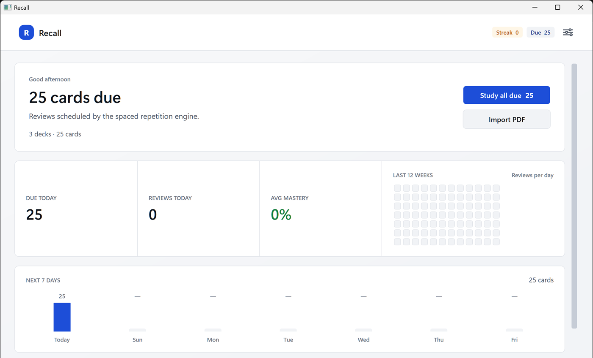
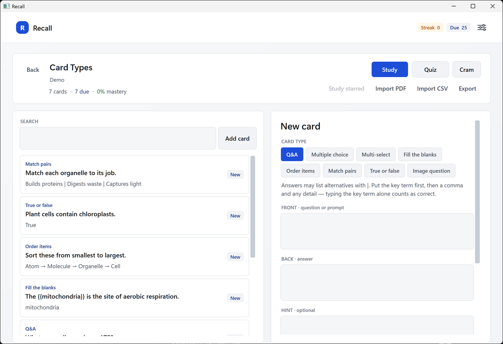
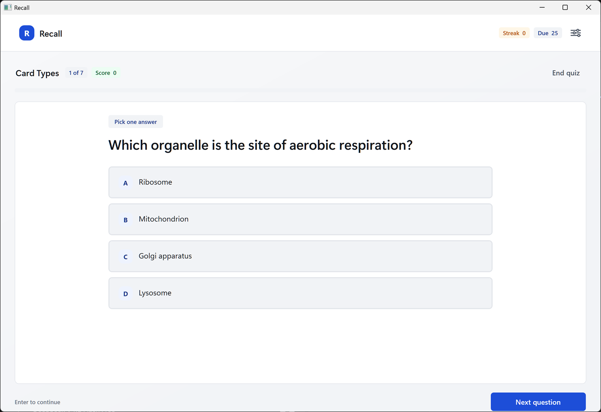
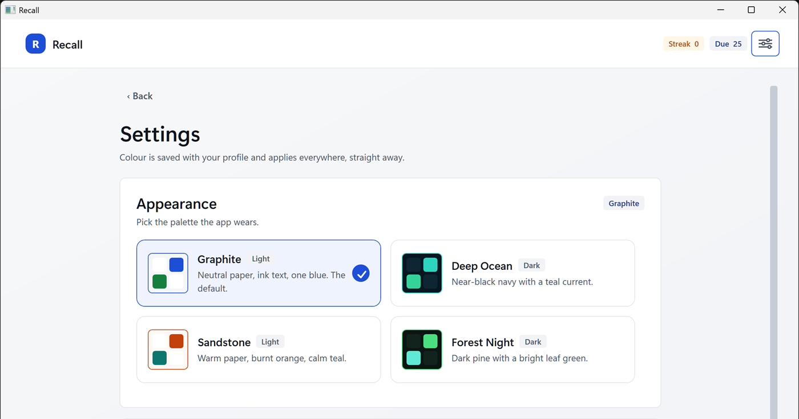

# Recall

A flashcard app for Windows. It keeps decks on your disk, schedules reviews with SM-2, and
asks eight kinds of question. A PDF importer turns a document into cards. There is no
account, no sync, and no AI: everything lives in one JSON file.



## What it does

- A deck library with due counts, mastery, a 12-week review heatmap, and a streak.
- SM-2 spaced repetition. Each card carries an ease factor, an interval, a lapse count, and
  a due date.
- Quiz mode and study mode over a whole deck, a filtered set, or everything due.
- A session summary with accuracy, time, the cards you missed, and a button to run the
  session again.
- PDF import that pulls definition-shaped pairs out of a document and shows them in a
  review list. Nothing is written until you press Add.
- Four palettes. Settings switches them and the running window repaints.



## Question types



| Type | Shape | Grading |
| --- | --- | --- |
| Q&A | Type the answer | Whole answer, key term, or key term as whole words |
| Multiple choice | Four options, one correct | Single pick |
| Multi-select | Four options, one or more correct | Exact set |
| Fill the blanks | `{{blank}}` in the prompt | Same matcher as Q&A |
| Order items | Reorder a shuffled list | Exact sequence |
| Match pairs | Left column to right column | Every pair |
| True or false | Statement plus a boolean | Single pick |
| Image question | Prompt plus a local image | Same matcher as Q&A |

Answers can list alternatives with `|`. The first alternative is the key term, so
`Mitochondria, the site of aerobic respiration` accepts `Mitochondria` alone but not
`Mitochondrion`. Typed answers must match exactly. A near miss scores zero.

## PDF import

The importer reads the text layer and guesses which lines are terms and which are answers.
It looks for headings, bold runs, `term: definition` lines, bullet lists under a heading,
and `x = meaning` lines. No model is involved, so it cannot tell when a sentence makes a
bad question. Some cards come out wrong: a definition that starts mid-sentence, a list that
only half survives, an answer that reads oddly on its own.

Read the review list before you press Add. Untick anything that does not make sense, and
edit the rest in the deck view afterwards. Scanned PDFs have no text layer, so they need
OCR before the importer can read them.

## Palettes



Graphite is the default: neutral paper, ink text, one blue for the action on the screen.
Deep Ocean and Forest Night are dark. Sandstone is warm paper. The choice is saved with your
profile and applies straight away.

## Install

Download `Recall-win-x64.zip` from
[Releases](https://github.com/Paolovz/quiz-flashcards/releases/latest), unzip it, and run
`Recall.exe`. Windows 11 on x64. There is no installer and no admin prompt.

## Where your data lives

```
%LOCALAPPDATA%\Recall\data.json
```

Decks, cards, review history, and the chosen palette go in that one file. A save writes to a
temporary name and then moves it into place, so an interrupted save leaves the previous
file intact. Set `RECALL_DATA_DIR` to use a different folder. The test runs set it so they
stay off a real profile.

Settings shows the exact path and can copy it.

## Layout

```
src/Recall.Core     models, store, SM-2, answer matching, quiz building, PDF import
src/Recall.App      WPF shell, views, view models, themes
tests/Recall.Tests  xunit tests over the core
```

Themes are one resource dictionary per palette in `src/Recall.App/Themes/Palette`. Every
brush reference in the views is a `DynamicResource`, so swapping the palette dictionary
repaints the running window.

## Keyboard

| Key | Action |
| --- | --- |
| `A`–`D`, `1`–`4` | Pick an option |
| `Enter` | Submit or advance |
| `Escape` | Leave the quiz |

## License

MIT. See [LICENSE](LICENSE).
